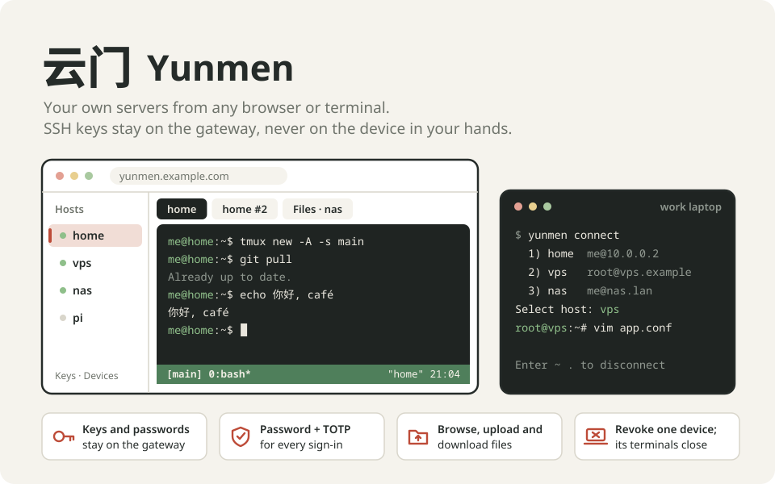

<h1 align="center">
  
</h1>

Yunmen is a lightweight self-hosted SSH gateway for one person and their own servers. Open a browser tab or run `yunmen connect` on any of your machines, and you get a real terminal on your home box, your VPS or your NAS. The SSH keys and passwords stay on the gateway. The laptop in front of you only holds a Yunmen credential that you can revoke.

I built Yunmen because I wanted my servers from anywhere: a browser on another machine, or the terminal on a work laptop. I didn't want to copy private keys to every device. A browser SSH tool covered part of that, but I kept seeing garbled characters I could never explain, and I wanted a CLI that went through the same gateway as the browser. So Yunmen does one job. It keeps a host list and the keys in one place, puts a password and TOTP in front of them, and passes terminal bytes through untouched, so vim, tmux, CJK text and emoji look the way they do over plain SSH.

The name is the pinyin for 云门, "cloud gate": a single gate in the cloud, in front of your servers.

## Features

- **Small by design.** Browser and CLI terminals, a shared host and key library, and simple file transfers in one Go binary with an embedded web UI and SQLite. The Linux amd64 container image is about **6.8 MB to download and 27.4 MB unpacked**.[^image-size]
- **Browser terminals.** Open as many tabs as you like, on one host or several. They are full PTYs, so tmux, vim, Ctrl-C and resizing behave as they do in a local terminal.
- **A CLI for your other machines.** `yunmen connect` opens the same hosts from Linux, macOS or Windows, with a searchable host picker. It needs no SSH key and no extra software on the client.
- **Keys stay home.** Generate an Ed25519 key on the gateway and paste its public line into `authorized_keys`, or import a key you already have. One key can serve many hosts. Hosts that use standard password authentication work too.
- **Host keys checked first.** Before Yunmen sends any credential to a new host, you confirm the host's fingerprint. If that key ever changes, the connection is refused.
- **Password and TOTP.** Every sign-in and every new CLI device needs both. Failed attempts are rate limited, and recovery codes let you replace a lost authenticator. If you want an extra outer gate, Yunmen can also require Cloudflare Access.
- **Devices you can see and revoke.** Each CLI install is approved in the browser and lasts 30 days. Revoke one device and its open terminals close right away. Your other devices keep working.
- **Simple file access.** Browse a host's directories, then download files, or upload them with progress and cancel. An upload never overwrites an existing file.
- **Nothing to babysit.** One small container with SQLite holds everything. Keys, passwords and the TOTP seed in it are encrypted with a master key that you keep.

Yunmen does not keep shells alive by itself. When a connection drops, reconnecting starts a new shell. Run [tmux](https://github.com/tmux/tmux) or [Kiwa](https://github.com/txchen/kiwa) on the host to pick up where you left off.

[^image-size]: Measured on 2026-10-31 for `ghcr.io/txchen/yunmen`, Linux amd64 manifest `sha256:56f17a6df2acb26c536612cc4a6ce39af3a16ec60b0d65f75a084849dfecb51d`. Download size is the sum of compressed registry layers; unpacked size is Docker's image size. MB is decimal. These figures describe the image, not runtime memory or stored data, and may change between releases.

## How to use

### 1. Run the gateway

The gateway runs as one container listening on `127.0.0.1:8080`. A Cloudflare Tunnel on the same host (or any HTTPS reverse proxy) publishes it under your own hostname, with no open port at home. [docs/deployment.md](docs/deployment.md) has the details. The short version:

```sh
cd deploy
mkdir -p data secrets
docker run --rm ghcr.io/txchen/yunmen:latest genkey > secrets/master.key   # keep a copy somewhere safe
chown -R 1000:1000 data secrets                                            # the user: in compose.yaml
chmod 700 data secrets && chmod 600 secrets/master.key
# in compose.yaml, set YUNMEN_PUBLIC_ORIGIN to your https:// address
docker compose up -d
docker compose run --rm -it yunmen init                                    # owner password, TOTP, recovery codes
```

Then point your tunnel's public hostname at `http://localhost:8080`. You can also build the image yourself with `docker build -t ghcr.io/txchen/yunmen:latest .`.

Back up the database and the master key separately. Neither works without the other. See [docs/operations.md](docs/operations.md) for backup, restore and recovery.

### 2. Add your servers in the browser

1. Open your Yunmen address and sign in with your password and TOTP code.
2. Under **Keys**, generate a key and add its public line to `~/.ssh/authorized_keys` on your servers. You can also import an existing private key.
3. Under **Hosts**, add a host: a name, a short alias for the CLI, the address, and the user. Check the host key. Compare the fingerprint with `ssh-keygen -lf /etc/ssh/ssh_host_ed25519_key.pub` run on the server, then save.
4. Press **Connect** for a terminal tab, or **Files** to browse.

### 3. Install the CLI on your other machines

Linux and macOS:

```sh
curl -fsSL https://raw.githubusercontent.com/txchen/yunmen/master/scripts/install.sh | sh
```

Windows, in PowerShell:

```powershell
irm https://raw.githubusercontent.com/txchen/yunmen/master/scripts/install.ps1 | iex
```

Both installers check the release checksum. On Linux and macOS, `yunmen` goes to `/usr/local/bin` if that directory is writable, otherwise to `~/.local/bin`. On Windows it goes to `%LOCALAPPDATA%\Programs\yunmen`, which the installer adds to your PATH. Set `YUNMEN_VERSION` to pin a release.

Then pair the machine once:

```sh
yunmen login https://yunmen.example.com
```

It prints a short code. In any signed-in browser, open **Approve device**, enter the code, and confirm with your password and TOTP. The CLI stores its credentials in the OS keychain, or in an owner-only file when no keychain is available.

| Command | What it does |
| --- | --- |
| `yunmen hosts` | List your hosts |
| `yunmen connect home` | Open a shell on the host with alias `home` |
| `yunmen connect` | Pick a host: type to filter, or enter a number |
| `yunmen logout` | Revoke this device and remove its local credentials |

Inside a session every key goes to the server, Ctrl-C included. Type `Enter ~ .` to disconnect from your side, as with OpenSSH.

### Devices, sign-out and recovery

- **Devices** lists every paired CLI with its last use and expiry. Revoking one ends its terminals immediately.
- If you lose your authenticator, use **Lost your authenticator?** on the sign-in page with your password and one recovery code. Every session and device is signed out afterwards. **Settings** generates fresh recovery codes.
- Without network access to the gateway, `yunmen logout` still removes the local credentials and tells you to revoke the device in the browser.

### Good to know

- Yunmen, and Cloudflare when you use a tunnel, decrypt your terminal traffic on the way through. This is not end-to-end encryption between your device and the server.
- The sign-in page is reachable by anyone who knows the address. Wrong guesses are rate limited per visitor and in total, so they cannot break in, but a determined attacker can briefly lock you out of signing in. See [docs/deployment.md](docs/deployment.md#exposure-without-cloudflare-access).
- Yunmen is at v0.1.x. The Linux CLI and the gateway are tested against real OpenSSH servers. The macOS, Windows and ARM builds have not been run yet.
- I've deployed the gateway myself and connected to it from the CLI. Long sessions through a real Cloudflare Tunnel, and the optional Cloudflare Access mode, still need testing in a real deployment. See [docs/open-questions.md](docs/open-questions.md).

## How to develop

You need Go 1.27+ and Node 24+. The integration tests also use OpenSSH `sshd`, `sftp-server`, `tmux` and `vim`, and are skipped when those are missing.

```sh
make web     # build the Vue app into web/dist (embedded in the server)
make test    # go vet, go test, web unit tests
make e2e     # real binaries in real PTYs, plus headless Firefox, against a local sshd
make build   # dist/yunmen-server and dist/yunmen
make image   # Docker image
```

To try the server locally without Cloudflare:

```sh
export YUNMEN_MASTER_KEY_FILE=./data/master.key YUNMEN_DATA_DIR=./data
mkdir -p data && go run ./cmd/yunmen-server genkey > data/master.key && chmod 600 data/master.key
go run ./cmd/yunmen-server init
YUNMEN_MODE=standalone YUNMEN_PUBLIC_ORIGIN=http://127.0.0.1:8080 go run ./cmd/yunmen-server
```

For hot reload, run `cd web && npm run dev` and start the server with `YUNMEN_PUBLIC_ORIGIN=http://localhost:5173`. The illustration above is generated by `docs/assets/make-hero.py`.

More: [API and terminal protocol](docs/api.md) · [requirements](docs/requirements.md) · [design decisions](docs/decisions.md) · [operations](docs/operations.md) · [open questions](docs/open-questions.md)
